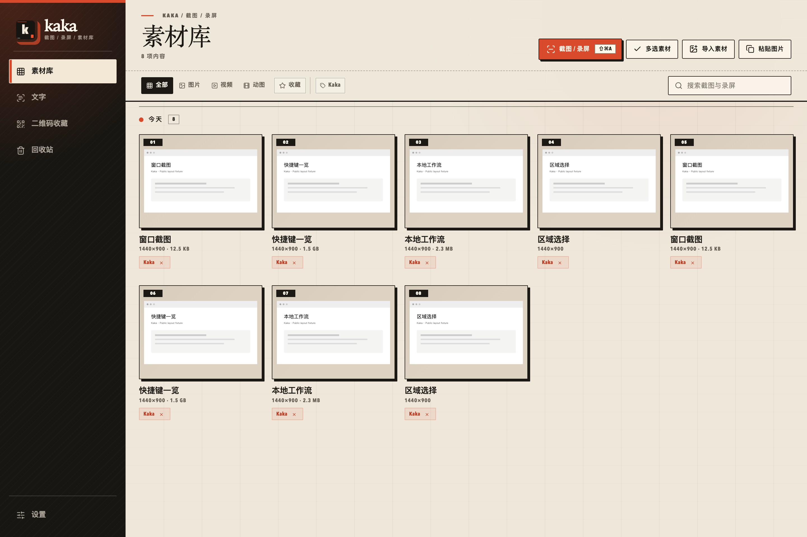

  
  <h1>Kaka</h1>
  
Screenshots, text recognition, and screen recording. Your captures stay local unless you explicitly share them.

  
For macOS, Windows, and Linux.

  
An independent fork of <a href="https://github.com/yuxino/Kiri">Kiri</a>.

  
<a href="https://github.com/cxq1221/kaka">GitHub</a> · <a href="https://github.com/cxq1221/kaka/releases/latest">Download the latest release</a>

  
<a href="../../README.md">简体中文</a> · <strong>English</strong> · <a href="zh-TW.md">繁體中文</a> · <a href="ja.md">日本語</a> · <a href="de.md">Deutsch</a> · <a href="ko.md">한국어</a> · <a href="fr.md">Français</a>

  

    
    
    
  

## Features

- Capture a window or region, add text, arrows or mosaic, and pin screenshots as floating references. Zoom and continue editing after saving.
- Scroll up or down to build a long screenshot; revisiting captured content does not add it twice (macOS, Windows, Linux X11).
- Extract text with local OCR and read QR codes.
- Record MP4 with optional system audio and microphone, or save a silent GIF.
- Trim and reorder clips from one video, then export a new MP4.
- Search, tag, favorite and export local captures, with Trash for accidental deletions.
- Explicitly share a screenshot from the capture toolbar or completion card to a local or trusted-LAN LanChat room; it appears in chat history and is never uploaded automatically.
- Set, disable or restore global shortcuts directly in Settings; recording controls are active only while recording ([Wayland uses desktop settings](../linux.md)).

## Get started

1. Press `⇧⌘A` on macOS or `Shift+Ctrl+A` on Windows / Linux X11 to open capture.
2. Choose Screenshot, Record, or OCR, then select a window or drag a region.
3. For screenshots, press `Enter` to finish or `Esc` to cancel. Finished screenshots go to your clipboard and library.

[Setup and help](../usage.md) · [Video editing](../video-editing.md) · [Linux](../linux.md) · [Report an issue](https://github.com/cxq1221/kaka/issues)

## Origin and license

Kaka is an independent fork of [Kiri](https://github.com/yuxino/Kiri), built on its MIT-licensed code. The original copyright notice remains in [LICENSE](../../LICENSE); see [NOTICE](../../NOTICE.md) for attribution.

## Thanks

Thank you to everyone who writes code, reports issues, tries Kaka, or shares it.

Special thanks to [@kerwin2046](https://github.com/kerwin2046) for [initial Linux support](https://github.com/yuxino/kiri/pull/20), and [@LLLin000](https://github.com/LLLin000) for [Windows text-scaling capture alignment](https://github.com/yuxino/kiri/pull/61).

Thanks also to the [V2EX](https://www.v2ex.com/), [LINUX DO](https://linux.do/), [Appinn](https://www.appinn.com/), [NodeLoc](https://www.nodeloc.com/) communities for their feedback and sharing.

[All contributors](https://github.com/cxq1221/kaka/graphs/contributors) · [Contributing](../../CONTRIBUTING.md) · [Privacy](../privacy/en.md) · [MIT](../../LICENSE) · [NOTICE](../../NOTICE.md) © 2026 cxq1221
